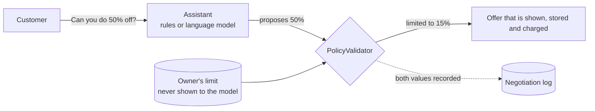

# AK&VEN

**An online shop and stock system for a family sock stall at Dordoi Bazaar in Bishkek, with a chat assistant that
can negotiate prices but can never go below the owners' limit.**

Bachelor's thesis, ELTE Faculty of Informatics, 2026
*Design and Implementation of AkVen Integrated E-Commerce and Inventory Management System*
Nurmuhammed Kanybekov · Supervisor: Guettala Walid

[](https://szofttech.inf.elte.hu/gnn/thesis-bachelor-2026-2027-01/nurmuhammed/-/commits/master)


## Contents

1. [Background](#background)
2. [The main idea: the assistant proposes, the server decides](#the-main-idea-the-assistant-proposes-the-server-decides)
3. [Features](#features)
4. [Running the project](#running-the-project)
5. [Architecture](#architecture)
6. [Testing](#testing)
7. [Documentation](#documentation)
8. [Repository layout](#repository-layout)

## Background

AK&VEN is my parents' sock business. The name joins their first names, **Ak**ylbek and **Ven**era. The family has
traded at Dordoi Bazaar since the early 2000s and has sold Korean-made socks from container 70-E since 2018.

Selling at a bazaar works differently from a typical web shop:

- customers expect to bargain;
- families buy for several people at once, so larger quantities should cost less per pair;
- shops from other regions buy whole cases;
- many customers prefer to pay in cash or by bank app when they collect the goods.

The project brings these habits online instead of replacing them with a fixed-price checkout. It also gives the
family the tools to run the stall: stock with a full history, orders, deliveries and hand-over at the stall.

## The main idea: the assistant proposes, the server decides

A language model is good at conversation, but it cannot be trusted with money. A customer can confuse it, flatter it
or inject instructions into it. In this system the assistant only **proposes** a price. A small deterministic
component, the `PolicyValidator`, **decides** what the customer actually gets.



- The model never sees the limit or the cost price. The customer's message is passed to it as data, not as
  instructions.
- Every proposal is limited **before** it is shown or saved, and checked again at checkout. A database constraint
  rejects any stored discount above the proposal.
- The model may not write prices in its own words in any of the three languages. The server inserts the allowed
  numbers, and a reply that contains its own price is replaced.

The guarantee therefore does not depend on how well the model behaves. In a recorded run with a live model (Gemini)
and 16 simulated customers, including a prompt-injection attempt, no final price went below the limit.

## Features


### For customers

- **Catalogue:** shelves for men, women, kids and gift sets, with filters for height, size and colour. Filters are kept
  in the address bar, so a filtered page can be shared.
- **Product page:** pictures for each colour, current stock ("only a few left", "arrives in about 5 days"), a
  back-in-stock notification, and a table showing how the price per pair falls with quantity.
- **Price negotiation:** a chat on every product in English, Russian or Kyrgyz. An accepted offer is valid for 24
  hours.
- **Quantity discounts:** any socks can be combined; the whole bag counts towards the next discount step.
- **Size help:** a size guide, a size finder, a fitting room that shows a sock's height with chosen shoes, and saved
  family profiles with shoe sizes.
- **Gift boxes** with a box, ribbon and a handwritten card.
- **Checkout without an account:** a guest order opens at a private link, which is also sent by email.
- **Reserve and pay on collection:** the customer reserves the socks online and pays in cash or by bank app at the
  stall or to the courier. The reservation holds the stock for 48 hours and is cancelled automatically if nobody
  comes.
- **Delivery options:** pickup at the stall with a six-digit code and QR code, a courier in Bishkek by area, or a
  cargo company to other regions, Kazakhstan, Uzbekistan and Russia. The fee and delivery time are shown before the
  order is placed.
- **Orders:** a timeline, cancellation until hand-over, and "order these again".
- **Emails** in the customer's language for every change of an order.
- **Wholesale:** shops build a case from the real catalogue, colour by colour and size by size, with current stock
  shown, and send it as a request without needing an account.
- **General:** English, Russian and Kyrgyz; prices in US dollars, som or roubles; light and dark themes; works on
  phones; installable as an app.

<table>
<tr>
<td width="62%"></td>
<td></td>
</tr>
<tr>
<td><em>The customer asks for 50%; the assistant offers only what the owners allow.</em></td>
<td><em>The home page on a phone, in Kyrgyz.</em></td>
</tr>
</table>

### For the shop team

The administration is available in English, Russian and Kyrgyz, with three roles.

- **Staff:** products, colours, sizes and pictures; stock and incoming deliveries; orders; the **hand-over desk**
  (enter or scan the pickup code, take payment for reserved orders); reviews; the wholesale inbox.
- **Inventory:** every stock change is recorded with its reason (opening stock, goods received, sale, cancellation,
  manual correction). Staff record arriving goods with one form, and each product variant shows its stock history.
  Stock is locked during checkout, so the last pair is never sold twice.
- **Owners:** price limits and cost prices, the discount steps, exchange rates, delivery areas, customers, contacts,
  opening hours, the size chart, sent emails, and order export to a spreadsheet. A low-stock alert is sent by email.
- **Super admin:** team accounts, the choice of assistant (rule-based or language model) with a connection test, and
  an audit log of every change with the values before and after.


**Not implemented, on purpose:** a real payment provider (card payments are simulated in the demo), SMS and taxes. A
Telegram bot is [planned](docs/telegram-bot-plan.md). The language model is optional; without an API key the
rule-based assistant answers.

## Running the project

You need Docker (on a Mac: Docker Desktop or Colima). In the project folder run:

```bash
docker compose up --build
```

Then open **http://localhost:8081**. The first build takes a few minutes. The backend is ready when its log shows
`Started AkVenApplication`.

| Demo account | Email | Password | Permissions |
|---|---|---|---|
| Super admin | `superadmin@akven.test` | `changeme-super` | Everything, plus team accounts, the assistant and the audit log |
| Owner | `admin@akven.test` | `changeme-admin` | The whole shop, including prices, delivery areas and the size chart |
| Staff | `staff@akven.test` | `changeme-staff` | Products, stock, orders, reviews and wholesale requests, but not prices |
| Customer | Create an account on the site | | Shopping, negotiation, checkout, order tracking |

Docker Compose starts the shop **in demo mode**. Demo mode loads a demo catalogue, three months of sample activity
(customers, orders, negotiations, reviews and wholesale requests), the accounts above, and a simulated card payment
that moves no money. Without demo mode the shop starts empty and safe: no demo data, no demo accounts and no card
payments until a real provider is connected. Setting a real super admin in `.env` also switches the demo accounts off.

A short tour:

1. Switch the language in the top bar (EN · РУС · КЫР).
2. Open a shelf, choose a size and a colour, then remove a filter.
3. Open a product and ask the chat for "50% off". The offer stays within the limit.
4. Put socks in the bag and choose **Reserve, pay at the stall** at checkout.
5. Open **http://localhost:8081/admin** as the owner. Hand the order over at the hand-over desk, record arriving
   goods on a product and look at its stock history.
6. As the super admin, read the audit log. To use a real language model, put `LLM_API_KEY=…` in `.env` (see
   `.env.example`), restart, and switch it on under *AI assistant*.

`docker compose down -v` deletes the local database so the next start is fresh. Running without Docker, all settings
and test commands are described in [`docs/development.md`](docs/development.md).

**Deployment.** The same Docker Compose setup runs on a small Linux server behind Caddy, which provides HTTPS.
`deploy/deploy.sh` backs up the database, updates the server to the latest `dev` commit and waits until
`/api/version` reports that commit. The full guide is in [`docs/deployment.md`](docs/deployment.md).

## Architecture


| Layer | Technology |
|---|---|
| Client | React 18, TypeScript, Vite. One installable PWA for customers and the team, with role-based routes. About 2,000 texts per language (English, Russian, Kyrgyz) with typed keys |
| API | Spring Boot 3.5, Java 17, about 115 endpoints in 21 feature packages. JWT with four roles, method-level security, one error format (RFC 7807), OpenAPI at `/swagger-ui/index.html` in demo mode |
| Data | PostgreSQL 16. 26 schema migrations and 19 demo-data migrations (Flyway). Check constraints enforce the rules that must never break |
| Assistant | A `Negotiator` interface with a rule-based implementation and a language-model implementation over any OpenAI-compatible API (Gemini by default), with fallback to the rules |
| Delivery | Docker Compose (database, backend, nginx). CI on GitHub Actions and on the ELTE GitLab |

Key design decisions (explained in [`docs/architecture.md`](docs/architecture.md) and in the thesis):

- **Prices are calculated only on the server.** The browser displays quotes; checkout recalculates everything.
- **Checkout is safe under concurrency.** Product variants are locked in a fixed order before stock is read, so the
  last pair is sold only once and two carts cannot deadlock. An idempotency key makes a double click charge once.
- **Every stock change has a reason.** A ledger records each movement, and a test checks that the ledger always adds up
  to the stock on hand.
- **Orders keep a snapshot** of names, prices paid and the delivery area, so receipts never change later.
- **Every change by the team is audited** in the same transaction, with the values before and after.
- **Customers can only see their own data.** The account is always taken from the token, never from the request.

## Testing

| Check | Command | Result |
|---|---|---|
| Backend | `cd backend && mvn verify` | 284 tests, **96% line coverage**; the build fails below 80% |
| Backend on PostgreSQL | see [`docs/development.md`](docs/development.md) | Migrations, constraints, and the last-pair and double-payment races over real HTTP |
| Frontend | `cd frontend && npm test && npm run build` | 213 tests, including translation completeness and WCAG AA colour contrast |
| End-to-end | `cd frontend && npm run e2e` | 29 steps in a real browser: the work of the owner, staff, customers (with and without an account) and the super admin, in three languages, with accessibility checks on every page |
| Other browsers | `cd frontend && npm run e2e:browsers` (in CI) | The customer journey in WebKit (Safari) and Firefox, on a phone and a laptop |

The tests show, among other things, that:

- no price goes below the owners' limit, whatever the assistant proposes, and a tampered offer is limited again;
- the assistant cannot state its own price in English, Russian or Kyrgyz;
- prices or delivery fees sent by the browser are ignored;
- an unpaid reservation expires and returns its stock;
- five wrong passwords lock sign-in for fifteen minutes, and sign-ups, chat messages and wholesale requests are
  rate-limited;
- database constraints reject invalid rows even if the application is bypassed.

## Documentation

| Document | Contents |
|---|---|
| [`docs/thesis/thesis.pdf`](docs/thesis/thesis.pdf) | **The thesis**: specification, user documentation, developer documentation, testing and evaluation (ELTE IK format) |
| [`docs/thesis/`](docs/thesis/) | LaTeX source; build with `latexmk -pdf thesis.tex` |
| [`docs/requirement-analysis.md`](docs/requirement-analysis.md) | Actors, use cases and requirements |
| [`docs/traceability.md`](docs/traceability.md) | Where each requirement is implemented and which test covers it |
| [`docs/architecture.md`](docs/architecture.md) | Layers, data model, the PolicyValidator, security |
| [`docs/user-guide.md`](docs/user-guide.md) | How owners, staff and customers use the shop |
| [`docs/development.md`](docs/development.md) | Running locally, settings, tests, CI, database |
| [`docs/deployment.md`](docs/deployment.md) | Putting the shop online: the choices and a first installation |
| [`docs/deploy-runbook.md`](docs/deploy-runbook.md) | Updating the running server, step by step, with checks, rollback and troubleshooting |
| [`docs/api.md`](docs/api.md) | The API and its error codes |
| [`docs/evaluation/`](docs/evaluation/) | The recorded run of the assistant with 16 simulated customers |
| [`docs/diagrams/`](docs/diagrams/README.md) | Architecture, validation path, negotiation sequence, data model, use cases |
| [`docs/brand.md`](docs/brand.md) | Logo, colours, typography and motion |
| [`docs/git-workflow.md`](docs/git-workflow.md) | Branches and publishing to GitLab |

## Repository layout

```
backend/     Spring Boot application, one package per feature:
             audit auth catalog delivery family negotiation order payment
             pricing review saved shop sizes stock user wholesale ...
             src/main/resources/db/migration   schema migrations (always applied)
             src/main/resources/db/seed        demo data (demo mode only)
frontend/    The shop and the administration (React + TypeScript)
             src/i18n      English, Russian and Kyrgyz texts
             scripts/      product pictures, icons, screenshots and end-to-end tests
deploy/      Server update script and Caddy configuration
docs/        Documentation, including the thesis
docker-compose.yml, .github/workflows/ci.yml, .gitlab-ci.yml
```
