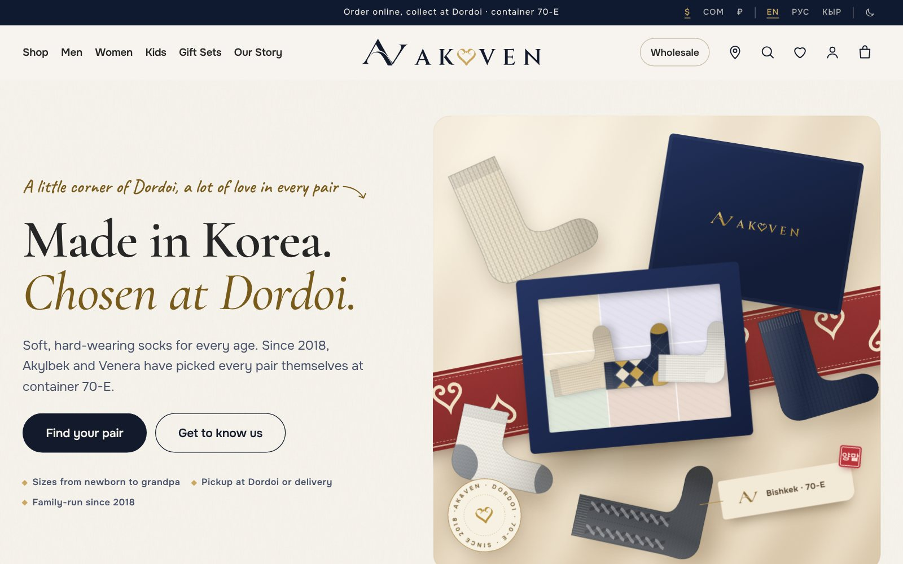
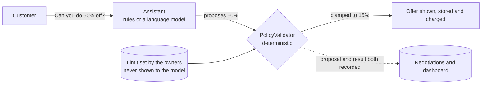
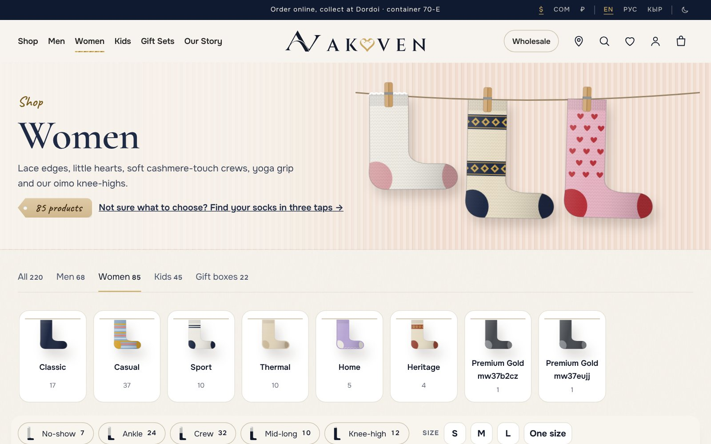
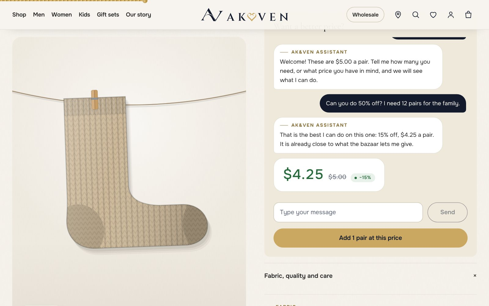
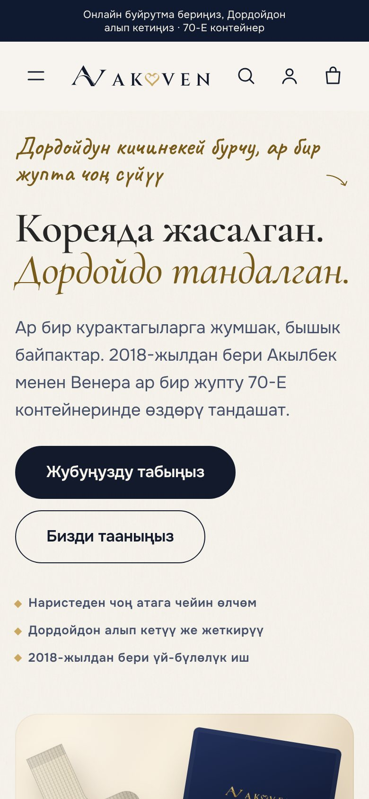
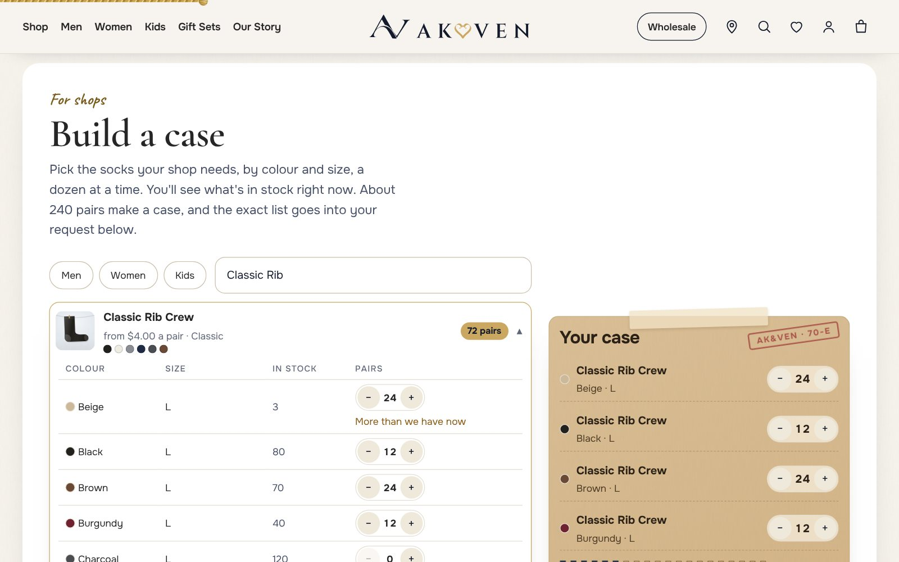
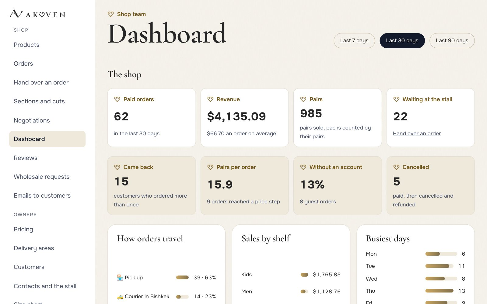
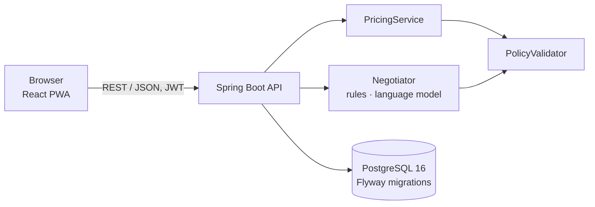
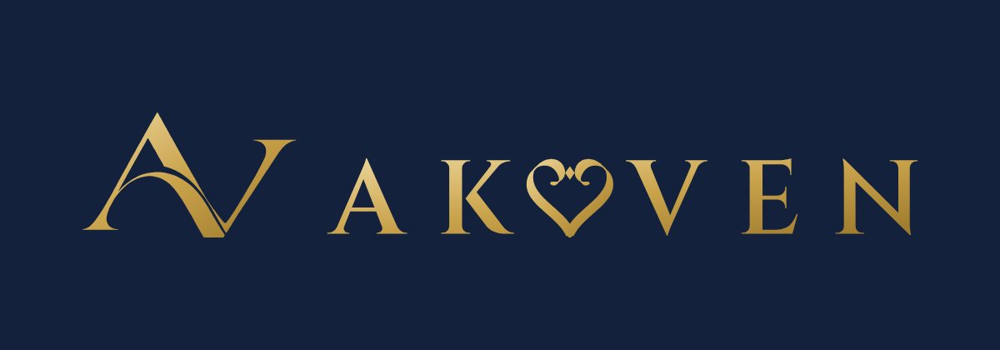

# AK&VEN

**The online shop of a family sock stall at Dordoi Bazaar, with a price-negotiating assistant that can never give away
more than the owners allow.**

Bachelor's thesis · ELTE Faculty of Informatics · 2026
Nurmuhammed Kanybekov · supervised by Guettala Walid

[](https://szofttech.inf.elte.hu/gnn/thesis-bachelor-2026-2027-01/nurmuhammed/-/commits/master)



## Contents

1. [In short](#in-short)
2. [The idea: talking is not deciding](#the-idea-talking-is-not-deciding)
3. [What the shop does](#what-the-shop-does)
4. [Run it in five minutes](#run-it-in-five-minutes)
5. [How it is built](#how-it-is-built)
6. [Quality and tests](#quality-and-tests)
7. [The thesis and the documentation](#the-thesis-and-the-documentation)
8. [Repository layout](#repository-layout)

## In short

AK&VEN is my family's brand of Korean-made socks: **AK** from Akylbek, **VEN** from Venera, and between them a gold
Kyrgyz ram's horn (кочкор мүйүз) shaped as a heart, for what they built together. My parents have traded at Dordoi Bazaar in Bishkek, Kyrgyzstan, since the
early 2000s and have sold socks there since 2018, from container 70-E. At the bazaar nobody pays the label price:
customers bargain, buy for the whole family, and shops from the regions buy by the case.

This shop keeps those habits online instead of replacing them with a fixed price tag:

- **Ask for your price.** A chat on every sock, in English, Russian or Kyrgyz, as at the stall.
- **The more pairs, the lower the price.** Any socks can be mixed; the whole bag counts towards the next step.
- **One set for the whole family.** Shoe sizes in, sock sizes and the price step out.
- **Three ways to get the socks, the way the family works:** collect at 70-E with a six-digit code; a **courier in
  Bishkek** (a taxi the family calls, or the father's own car above an amount the owners set); or **cargo** to the
  regions, Kazakhstan, Uzbekistan and Russia, where the customer pays the carrier on receipt. Fee and days are shown
  before paying.
- **Shops buy by the case.** They pick the exact socks from the real shelves, colour by colour and size by size, a
  dozen at a time, with the stock beside each; the list goes into a request the family answers from an inbox.
- **It looks like where it comes from.** Kyrgyz shyrdak felt and ram's horns (кочкор мүйүз), Korean hanji paper,
  bojagi patchwork and a red dojang seal run through the whole site, because the socks are knitted in Korea and chosen
  in Kyrgyzstan.

## The idea: talking is not deciding

A language model is good at conversation and not safe to trust with money: it can be confused, flattered or tricked
into a discount the business cannot afford. So the assistant only **proposes**; a small deterministic component
**decides**.



- The model never sees the limit or the cost price, and the customer's text is passed to it as data.
- Every proposal is clamped to the owners' limit for that sock **before** anything is shown, saved or charged, and
  again at checkout. The database refuses an allowed discount larger than its proposal.
- The model may not write a number in its own words, in any of the three languages; the shop fills in the allowed
  numbers. A reply that tries is replaced.
- Proposal and result are recorded side by side for every conversation.

The guarantee therefore does not depend on how well the model behaves. In a recorded run of a live model (Gemini) on
16 simulated customers, including a prompt-injection attempt, **no final price went below the limit**, for the
rule-based assistant (which over-promised six times by design) or for the model.

## What the shop does



**For customers**

- **Shelves with character.** Men, women, kids and gift boxes each open on their own fabric with their socks pegged on
  a washing line. The owners' sections are drawn as occasions; heights, **sizes and colour swatches** filter with live
  counts, every choice is a tag to remove, and the list grows twelve at a time. Everything lives in the address bar.
- **The product page:** pictures that follow the colour, honest stock ("only a few left", "arrives in about 5 days",
  "tell me when it's back"), **how the price falls** as pairs add up, the size finder, the same design for the rest of
  the family, reviews from customers who received the sock, and a bar that keeps *Add to bag* in reach.
- **Ask for a better price** in the chat: it remembers the conversation, answers about the sock, and shows the offer,
  which stays valid for 24 hours, for at least the pairs it was made for, once.
- **The fitting room:** our socks drawn on a leg with the chosen shoes and trousers, each height rated for them.
- **The family planner and family profiles** (sizes, birthdays), **gift boxes** with a ribbon and a hand-written card,
  the **sock finder** in three taps, and a **size guide** in the sizes each customer knows.
- **The bag as one collection:** minimum order, the step reached, "add 4 more pairs to save 5%", **save for later**.
- **Checkout without an account:** a guest gives an email; the order opens at a private link (an HMAC of the order
  id, never stored, kept after the `#` so it reaches no server log) that is emailed too, and a lost link can be
  emailed again without telling anyone which orders exist.
- **Checkout:** pickup with a code and a QR code, a courier by **area** with its fee, days and free-from amount, or a
  **cargo carrier** with its note and "paid to the carrier on receipt";
  **remember my details** for next time; a simulated Apple Pay / Google Pay wallet (no money moves).
- **Orders** with a timeline, cancel with refund until handover, and *order these again*.
- **Emails in the customer's language** (English, Russian or Kyrgyz): the confirmation with the pickup code or the
  delivery details, "collected / on its way / with the carrier", and a cancellation with its refund. They are written in
  the same transaction as the order (an outbox), sent through any SMTP server, retried when it is down, and readable
  in the admin; without a mail server they are kept there and the admin says so.
- **Wholesale and company gifts:** an open case of packs, how a case is made, and *Build a case* from the real
  shelves: search or browse a shelf, open a sock, and choose dozens of each colour and size with today's stock beside
  it (a warning when the case asks for more than there is); the case shows the price step it reaches and an estimate,
  and its exact list (one line per colour and size, with the code) goes into a request that needs no account.
- **Our story:** the family's two names, a letter from the stall in their own words, the years at Dordoi, the journey
  of a pair from the Korean mills to container 70-E, a day at the stall from 8:00 to 16:00, and the bazaar scene.
- **Find us:** whether the stall is open now in Bishkek time, the week's hours, the way inside the bazaar, Google Maps
  and 2GIS. The footer shows the stall's door with an open or closed sign.
- **English, Russian and Kyrgyz**; prices in **US dollars, som or roubles**; light and dark; phone, tablet and laptop;
  installable as an app, with the bag working offline; recently viewed and shareable saved socks; a privacy page that
  says what is kept and why.

<table>
<tr>
<td width="62%"></td>
<td></td>
</tr>
<tr>
<td><em>Asked for 50%, the assistant offers what the owners allow.</em></td>
<td><em>On a phone, in Kyrgyz.</em></td>
</tr>
</table>



**For the shop team** (the administration, in English, Russian and Kyrgyz)

- **Everyone in the team:** products (newest first, with pictures and colours) with sizes, pictures per colour, stock
  and stock on the way; sections and cuts; orders found by number, name, phone or email and by how they travel; the
  **hand-over desk** (code typed or scanned, plus the end of the phone number, and the pickup orders waiting to be
  packed); negotiations with proposed and allowed side by side; a dashboard that tells the story of the period
  (returning customers, pairs per order, how orders travel, sales by shelf, the busiest days, the best customers);
  review moderation; the **wholesale inbox** with one-tap reply in the customer's own messenger.
- **Owners:** the limit and cost of each sock, the price ladder and minimum order, som and rouble rates, **delivery
  areas**, customers with their orders and spending, contacts, the stall and its hours, the size chart, the emails sent
  to customers, and the orders as a spreadsheet. Prices can be read in dollars, som or roubles.
- **Super admin:** the team's accounts, which assistant answers the chat (with a test box, a connection test that says
  in plain words why the AI is not answering, and the live comparison), and the history of every change, by part of
  the shop and by who made it, with the values before and after.



**Not built, on purpose:** a real payment provider (the demo wallet is simulated), SMS, taxes, and the Telegram bot
([planned](docs/telegram-bot-plan.md)). The language model is optional: without a key the built-in rules answer.

## Run it in five minutes

You need Docker (on a Mac, Docker Desktop or Colima). From the project folder:

```bash
docker compose up --build
```

Then open **http://localhost:8081**. The first build takes a few minutes; the backend is ready when its log says
`Successfully applied 41 migrations`.

| Demo account | Email | Password | Can do |
|---|---|---|---|
| Super admin | `superadmin@akven.test` | `changeme-super` | Everything an owner can, plus accounts, the assistant and the audit log |
| Owner | `admin@akven.test` | `changeme-admin` | Everything in the shop, including prices, delivery areas and the size chart |
| Staff | `staff@akven.test` | `changeme-staff` | Products, stock, orders, reviews and wholesale requests, but not prices |
| Customer | Sign in → Create an account | | Shop, ask for a price, check out, follow orders |

Docker Compose starts the shop **in demo mode** (`SPRING_PROFILES_ACTIVE=demo`): the demo catalog, three months of
imagined shop life (25 customers from Bishkek, Osh, Almaty, Tashkent and Moscow, 150 orders in every state and way of
delivery, price conversations, reviews, wholesale requests and emails), these accounts, and a
**simulated wallet** that moves no money and says so at checkout. Without demo mode the shop is safe by default: no demo
data, the demo accounts switched off, and no payments taken until a real provider is connected (future work). The demo
accounts are also switched off in demo mode once a real super admin is set in `.env`, unless `DEMO_ACCOUNTS=on`.
A short tour:

1. **Switch the language** in the top bar (EN · РУС · КЫР); the whole site follows.
2. **Open a shelf**, pick a size and a colour, then take a filter off with its tag.
3. **Plan a family set** on the home page: change a shoe size and watch the sock size and the price step.
4. **Ask for a better price** as a customer: open a sock and type "50% off". The offer stays within the limit.
5. **Check out** with a courier or cargo: choose an area or a carrier, see its fee and days, tick *Remember my details*, pay with the
   simulated wallet.
6. **Send a wholesale request**, then open **http://localhost:8081/admin** as the owner: answer it from the inbox, hand
   an order over with its code, change a delivery area, read the dashboard.
7. **As the super admin**, add a staff account, read the audit log, and try the assistant. To let a real model answer,
   put `LLM_API_KEY=…` in `.env` (see `.env.example`), restart, and switch it on under *AI assistant*.

Start again from an empty database with `docker compose down -v`. Running without Docker, every setting and every test
command are in [`docs/development.md`](docs/development.md).

## How it is built



| Layer | Technology |
|---|---|
| Client | React 18, TypeScript, Vite. One installable PWA for customers and the team, role-gated routes. About 1,900 texts per language in English, Russian and Kyrgyz, with typed keys |
| API | Spring Boot 3.5, Java 17, 112 endpoints in 21 feature packages. JWT with four roles (customer, staff, owner, super admin) and a role hierarchy; method security on the services; one error format (RFC 7807); OpenAPI at `/swagger-ui/index.html` (demo mode; `API_DOCS=true` elsewhere) |
| Data | PostgreSQL 16 with pgvector. 41 Flyway versions: 23 schema migrations, 18 demo-data migrations (demo profile only). Check constraints repeat the rules that must never break |
| Assistant | A `Negotiator` interface: rule-based, and a language model over any OpenAI-compatible API (Gemini by default), with fallback to the rules and a run-time switch |
| Delivery | Docker Compose (database, backend, nginx). CI on GitHub Actions (six jobs) and on the ELTE GitLab |

The design rests on a few deliberate choices, all explained in [`docs/architecture.md`](docs/architecture.md) and in
the thesis:

- **Prices are decided only on the server.** The browser shows quotes; checkout recomputes everything.
- **Checkout is safe under races.** The options in the bag are locked in a fixed order before stock is read, so the
  last pair is sold once and opposite carts cannot deadlock; an idempotency key makes a double click charge once.
- **Receipts never change.** An order keeps a copy of the names, pictures, prices paid and delivery area.
- **Every change by the team is audited** in the same transaction, with the state before and after.
- **Each customer sees only their own** family, saved socks, details and orders: the account comes from the token, never
  from the request.
- **The look comes from the stall and its two countries:** kraft tags, the family's handwriting, socks on a washing
  line and container 70-E; Kyrgyz shyrdak felt and ram's horns; Korean hanji paper, bojagi patchwork and the red
  dojang seal. All 1,300 product pictures are drawn by a script from the same sock shapes as the interface, on a
  transparent ground, so each stands on a crafted backdrop chosen by the shop (and a cut-out photo would too).
- **Smooth on a phone:** textures are small pictures drawn once, cards move only what the graphics card can move, and
  endless animations rest while they are off screen; measured with the CPU slowed to phone speed.

## Quality and tests

| Check | Command | Result |
|---|---|---|
| Backend, in-memory database | `cd backend && mvn verify` | 271 tests, **96% line coverage**; the build fails below 80% |
| Backend on real PostgreSQL | see [`docs/development.md`](docs/development.md) | 11 tests: migrations, constraints, the last-pair and double-payment races over real HTTP |
| Frontend | `cd frontend && npm test && npm run build` | 208 tests: checkout sends no price or card, every text exists in Russian and Kyrgyz, WCAG AA contrast of every colour pair |
| In a real browser | `cd frontend && npm run e2e` | 28 steps: the owner's, the customer's (with and without an account) and the super admin's work in three languages, with accessibility rules on every page |
| Other browsers | `cd frontend && npm run e2e:browsers` (in CI) | The customer's path in Safari's engine (WebKit) and Firefox, on a phone and a laptop |

What the tests demonstrate, among others:

- No price ever goes below the owners' limit, whatever the assistant proposes, and a tampered offer is re-clamped.
- The assistant cannot state a price of its own in English, Russian or Kyrgyz.
- A fee or a price sent by the browser is ignored; delivery is charged by the area the server knows.
- Five wrong passwords lock sign-in for fifteen minutes; sign-ups, chat messages and wholesale requests are
  rate-limited; a disabled account or a new password ends its sessions at once.
- Database constraints refuse impossible rows even when the application is bypassed.

## The thesis and the documentation

| Document | What it covers |
|---|---|
| [`docs/thesis/thesis.pdf`](docs/thesis/thesis.pdf) | **The thesis**: specification, user documentation, developer documentation, testing and evaluation (ELTE IK format) |
| [`docs/thesis/`](docs/thesis/) | Its LaTeX source; build with `latexmk -pdf thesis.tex` |
| [`docs/requirement-analysis.md`](docs/requirement-analysis.md) | Actors, use cases, requirements |
| [`docs/traceability.md`](docs/traceability.md) | Each requirement: where it is implemented and which test shows it |
| [`docs/architecture.md`](docs/architecture.md) | Layers, data model, the PolicyValidator, security |
| [`docs/user-guide.md`](docs/user-guide.md) | How the owners, the staff and the customers use the shop |
| [`docs/development.md`](docs/development.md) | Running, settings, tests, CI, database |
| [`docs/deployment.md`](docs/deployment.md) | Putting the shop online: why one small server, step by step, email, payments, a security checklist |
| [`docs/telegram-bot-plan.md`](docs/telegram-bot-plan.md) | The planned Telegram bot: order messages, an AI helper that links to the shop, and handing over to the family |
| [`docs/api.md`](docs/api.md) | The API and its error codes |
| [`docs/evaluation/`](docs/evaluation/) | The recorded live run of the assistant on 16 simulated customers |
| [`docs/diagrams/`](docs/diagrams/README.md) | Architecture, validation path, negotiation sequence, data model, use cases |
| [`docs/brand.md`](docs/brand.md) | Logo, colours, type, motion; screenshots in [`docs/design/`](docs/design/) |
| [`docs/git-workflow.md`](docs/git-workflow.md) | Branches and publishing to GitLab |

## Repository layout

```
backend/     Spring Boot application, by feature: audit auth catalog delivery family negotiation order
             payment pricing review saved shop sizes stock user wholesale ...
             src/main/resources/db/migration   schema migrations (always applied)
             src/main/resources/db/seed        demo data (demo profile only)
frontend/    The shop and the administration (React + TypeScript)
             src/i18n      English, Russian and Kyrgyz
             src/brand     the logo and the drawn socks
             scripts/      product pictures, logo, icons, screenshots and the end-to-end test
docs/        Everything written down, including the thesis
docker-compose.yml, .github/workflows/ci.yml, .gitlab-ci.yml
```


