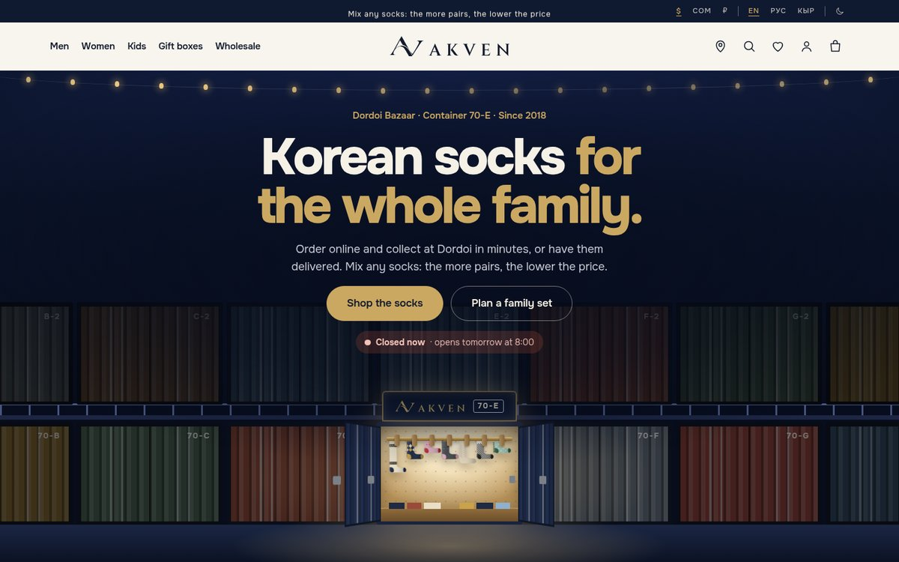
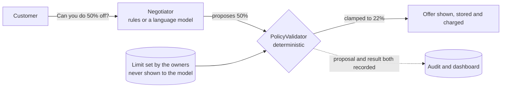
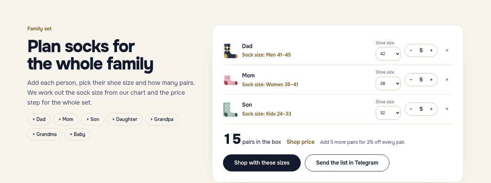
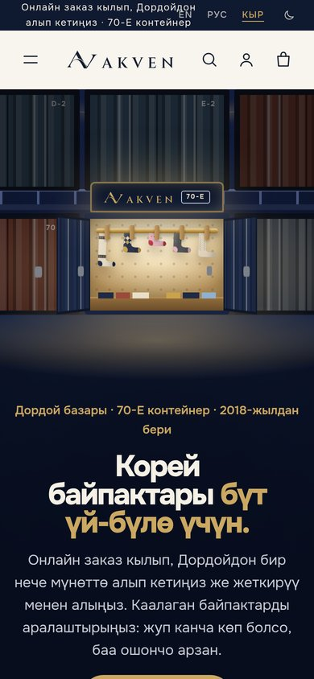
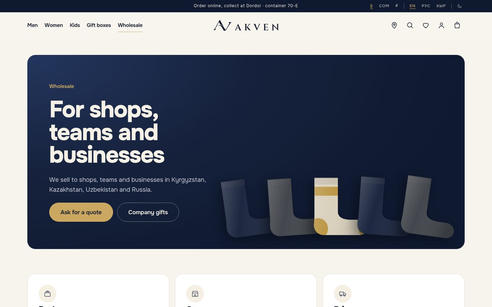
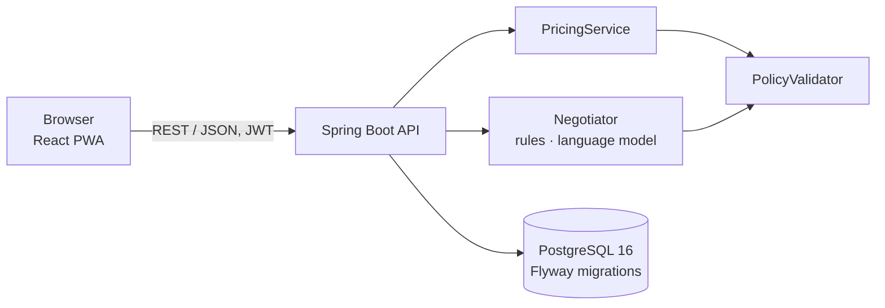
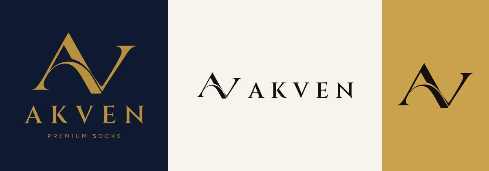

# AKVEN

**An online shop for a family sock business, with a price-negotiating assistant that can never give away more than the owners allow.**

Bachelor's thesis · ELTE Faculty of Informatics · 2026
Nurmuhammed Kanybekov · supervised by Walid Guettala

[](https://szofttech.inf.elte.hu/gnn/thesis-bachelor-2026-2027-01/nurmuhammed/-/commits/master)



## Contents

1. [The project in short](#the-project-in-short)
2. [The problem and the idea](#the-problem-and-the-idea)
3. [What the shop does](#what-the-shop-does)
4. [Try it in five minutes](#try-it-in-five-minutes)
5. [How it is built](#how-it-is-built)
6. [Quality and tests](#quality-and-tests)
7. [Status](#status)
8. [Documentation](#documentation)
9. [Repository layout](#repository-layout)

## The project in short

AKVEN is my family's brand of Korean-made socks. My parents, Akylbek and Venera, have traded at Dordoi Bazaar in
Bishkek, Kyrgyzstan, since the early 2000s and have sold socks there since 2018, from container 70-E. At the bazaar
nobody pays the label price: customers bargain, buy for the whole family, and shops from the regions buy by the case.

This project is the brand's online shop. It does not replace those habits with a fixed price tag; it brings them
online:

- **Families** plan one set for everyone (sizes, number of pairs) and collect it at the container in minutes, or have
  it delivered to Kyrgyzstan, Kazakhstan, Uzbekistan or Russia.
- **The more pairs, the lower the price.** Any socks can be mixed, and the whole bag counts towards the next step.
- **Customers can ask for their price** in a chat with an assistant, in English, Russian or Kyrgyz, as they would at the stall.
- **Shops and companies** send wholesale and gift-box requests straight to the owners' WhatsApp, Telegram or email.

## The problem and the idea

A language model is good at conversation and not safe to trust with money. It can be confused, flattered or simply
tricked into offering a discount the business cannot afford.

The thesis separates **talking** from **deciding**:



- The assistant only **proposes** a discount. It never sees the limit or the cost price.
- A small `PolicyValidator` **clamps** every proposal to the limit stored for that sock, before anything is shown,
  saved or charged. The same check applies to the collection discount at checkout.
- What was proposed and what was allowed are **both recorded** for every conversation, and every order line records
  which rule set its price.

So the guarantee does not depend on how well the model behaves: a model that is tricked, confused or wrong cannot
change what the customer pays. The evaluation compares a rule-based and a language-model negotiator on the same
simulated customers; the AI answers in the report are a recorded run of a live model (Gemini), and the
super admin can repeat that run at any time.

## What the shop does

<table>
<tr>
<td width="62%"></td>
<td></td>
</tr>
<tr>
<td><em>The family planner: shoe size to sock size from the shop's own chart, and the price step for the whole set.</em></td>
<td><em>On a phone, in Kyrgyz.</em></td>
</tr>
</table>

**For customers**

- **English, Russian and Kyrgyz**, prices in **US dollars, Kyrgyz som or Russian roubles** (at the rates the owners
  set), light and dark, on phone, tablet and laptop. The site can be installed as an app
  (PWA), and the bag works offline.
- **The collection box on the home page:** tap socks into the AKVEN box and watch the price step reached on the
  shop's real ladder.
- **Collections:** a minimum order and a price ladder counted in pairs across the whole bag, with "add 4 more pairs
  to save 5%" hints in the bag. Packs show their price per pair.
- **About 120 drawn designs and over 600 options** in the demo catalogue: a classic line of plain and ribbed socks in
  every height and up to ten colours, and patterns from argyle and cable knit to the Kyrgyz oimo and shyrdak, cats,
  bunnies and football socks. **The picture follows the colour** you choose, on the product page and in quick view.
- **The family planner:** add each person and their shoe size; the sock size comes from the size chart, and the list
  can be sent to the shop in a message.
- **Ask for your price:** a negotiation chat on every product page, in the customer's language. It remembers the
  conversation, answers questions about the sock, and shows the reason for each price.
- **Honest stock:** in stock, only a few left, arrives in about N days, or sold out, with **"Tell me when it's
  back"** on sold-out options.
- **Order again** from any past order in one tap, and a **QR code** on the pickup ticket that the stall can scan.
- **Size guide** in the sizes each customer knows (EU and US in English, local sizes in Russian and Kyrgyz), with a
  shoe-size finder and how to measure.
- **Pickup at Dordoi** with a six-digit pickup code, or delivery to four countries.
- **Wholesale and company gifts:** packs, cases, gift boxes for 23 February, 8 March, Nooruz and New Year, and a
  request form that opens in WhatsApp, Telegram or email, already written.
- **Quick view** on every sock card: choose colour and size and add to the bag without leaving the shelf.
- **Find us:** whether the stall is open right now (Bishkek time), the week's hours, the address step by step, and
  links to Google Maps and 2GIS.
- Saved socks, recently viewed, "complete the set", and checkout with a simulated Apple Pay or Google Pay wallet.

**For the shop team (the admin, in English, Russian and Kyrgyz)**

- Products, sections, cuts, colours, sizes, photos (each can belong to one colour), stock on the way and wholesale
  case sizes.
- Orders, and a hand-over screen for the stall (pickup code, typed or scanned from the customer's QR code, plus the
  end of the customer's phone number).
- A dashboard: paid orders, revenue and pairs sold, orders waiting at the stall, socks running out with what is on
  the way, customers waiting for a sold-out option (to write to when it is back); and for the assistant, offers per day, how often the limit stepped in, offers that became orders, best sellers.
- The rule-based against AI comparison, for the evaluation chapter.
- Owners only: the minimum order, the price ladder, the som and rouble rates, trusted customers (and a new password or switching
  off for a customer account), contacts, the stall and its opening hours, and the size chart.
- Super admin only: the team's accounts (add, disable, new password), which assistant answers the chat (the AI or the
  rules), a test box and the live comparison, and the full audit log.

**Not built, on purpose:** a real payment provider (the wallet is simulated; no money moves), email and SMS
notifications. The language model is optional: without a key the built-in rules answer.



## Try it in five minutes

You need Docker (on a Mac, Docker Desktop or Colima). From the project folder:

```bash
docker compose up --build
```

Then open **http://localhost:8081**. The first build takes a few minutes. The backend log ends with
`Successfully applied 28 migrations … now at version v28` when everything is up.

| Demo account | Email | Password | Can do |
|---|---|---|---|
| Super admin | `superadmin@akven.test` | `changeme-super` | Everything an owner can, plus accounts, the AI assistant and the audit log |
| Owner | `admin@akven.test` | `changeme-admin` | Everything in the shop, including prices, contacts and the size chart |
| Staff | `staff@akven.test` | `changeme-staff` | Products, stock and orders, but not prices |
| Customer | Create one with "Sign in" → "Create an account" | | Shop, check out, see orders |

These accounts exist only in demo mode, and are switched off as soon as you set up your own super admin in `.env`
(`SUPER_ADMIN_EMAIL`, `SUPER_ADMIN_PASSWORD`), unless you also set `DEMO_ACCOUNTS=on`. A short tour:

1. **Switch the language** in the top bar (EN · РУС · КЫР). The whole site follows.
2. **Fill the collection box** on the home page, then **plan a family set**: change a shoe
   size and watch the sock size and the price step change.
3. **Ask for a better price.** Sign in as a customer, open any product and type "50% off". The assistant answers, but
   the offer stays within the limit.
4. **Fill the bag** with 20 pairs of mixed socks to reach the first collection step, then pay for a pickup order with
   the simulated wallet to get a pickup code.
5. **Open the admin** at http://localhost:8081/admin as the owner. Hand the order over with its code, change the
   price ladder, and look at the negotiation dashboard and the comparison. Switch the admin to Russian or Kyrgyz at the
   bottom of the menu.
6. **Sign in as the super admin** to add a staff account, read the audit log, and try the AI assistant. To let a real
   model answer, put `LLM_API_KEY=…` in a `.env` file next to `docker-compose.yml` (see `.env.example`), restart, and
   switch it on under AI assistant.

To start again from a clean database: `docker compose down -v`, then `docker compose up --build`. If the browser
still shows an older version, hard-refresh it (Cmd+Shift+R on a Mac).

Running the backend and frontend without Docker, the settings and every test command are in
[`docs/development.md`](docs/development.md). Checking that a laptop has the latest version, and publishing to GitLab,
are in [`docs/git-workflow.md`](docs/git-workflow.md).

## How it is built



| Layer | Technology |
|---|---|
| Client | React 18, TypeScript, Vite. One installable PWA for customers and the admin. English, Russian and Kyrgyz |
| API | Spring Boot 3.3, Java 17. JWT with three roles (customer, staff, owner). One error format (RFC 7807). OpenAPI at `/swagger-ui/index.html` |
| Data | PostgreSQL 16 with pgvector. 28 Flyway versions (schema, plus demo data only in the demo profile) |
| Assistant | A `Negotiator` interface with two implementations: rule-based, and a language model (Gemini by default, any OpenAI-compatible API) that holds a conversation in three languages, with automatic fallback to the rules. The super admin switches between them at run time |
| Delivery | Docker Compose. CI on GitLab (`.gitlab-ci.yml`) and GitHub Actions (six jobs) |

The layers, the data model and the safety mechanism are described in [`docs/architecture.md`](docs/architecture.md).
The brand (logo, colours, type, motion) is described in [`docs/brand.md`](docs/brand.md).



## Quality and tests

| Check | Command | Result |
|---|---|---|
| Backend unit and integration tests, in-memory database | `cd backend && mvn verify` | 214 tests, **97% line coverage**; the build fails below 80% |
| Backend on real PostgreSQL | see [`docs/development.md`](docs/development.md) | 10 tests: migrations, constraints, the last-pair and double-payment races over real HTTP |
| Frontend | `cd frontend && npm test && npm run build` | 138 tests, including colour-contrast checks and a check that every text exists in Russian and Kyrgyz |
| End to end, in a real browser | `cd frontend && npm run e2e` | 25 steps: the owner's, the customer's and the super admin's whole journey in three languages, with accessibility rules on every page |

Safety properties that the tests demonstrate:

- No price ever goes below the owners' limit, whatever the assistant proposes.
- Prices are decided only on the server; the browser's numbers are never trusted.
- The last pair is sold once, even when two people pay at the same moment, and a double click never charges twice.
- The AI cannot state a price of its own in English, Russian or Kyrgyz; a reply that tries is replaced.
- Login lockout after repeated failures, a sign-up limit per address, four roles, a disabled account or a new password
  ends its sessions at once, an audit log of every change, and database constraints that refuse impossible values even
  if the application is bypassed.
- Each installation signs its logins with its own random key (no key is written in the repository), demo accounts are
  switched off on a real installation, and the web server sends a strict Content-Security-Policy; CI checks the
  headers on every push.

## Status

| Milestone | Due | State |
|---|---|---|
| M1: requirement analysis, design | 25 September | Done |
| M2: working prototype | 20 October | Done |
| M3: final program, CI/CD, over 80% coverage | 10 November | Feature-complete; see the open points below |
| M4: thesis draft | 22 November | In progress |

Open points: real product photos, the family's own story text, a native speaker's check of the Russian and
Kyrgyz texts, and whether to add a small user study to the recorded live-model evaluation. Details
are in [`docs/progress.md`](docs/progress.md); every requirement, where it is implemented and which test shows it, is
in [`docs/traceability.md`](docs/traceability.md).

## Documentation

| Document | What it covers |
|---|---|
| [`docs/requirement-analysis.md`](docs/requirement-analysis.md) | Actors, use cases, functional and non-functional requirements |
| [`docs/traceability.md`](docs/traceability.md) | Each requirement: where it is implemented, which test shows it, what is open |
| [`docs/architecture.md`](docs/architecture.md) | Layers, data model, the PolicyValidator and the security notes |
| [`docs/progress.md`](docs/progress.md) | Status against the milestones |
| [`docs/user-guide.md`](docs/user-guide.md) | How the owners, the staff and the customers use the shop |
| [`docs/development.md`](docs/development.md) | Running, settings, tests, CI, database |
| [`docs/git-workflow.md`](docs/git-workflow.md) | Branches, checking a laptop is up to date, publishing to GitLab |
| [`docs/api.md`](docs/api.md) | The API endpoints and error codes |
| [`docs/evaluation/`](docs/evaluation/) | The recorded live run of the AI assistant on the 16 simulated customers |
| [`docs/diagrams/`](docs/diagrams/README.md) | Thesis figures: architecture, validation path, negotiation sequence, data model (generated from the database), use cases |
| [`docs/wireframes.svg`](docs/wireframes.svg) | Wireframes of the key screens on phone, tablet and laptop |
| [`docs/brand.md`](docs/brand.md) | Logo, colours, type, ornaments, motion; screenshots in [`docs/design/`](docs/design/) |

## Repository layout

```
backend/     Spring Boot application
             src/main/resources/db/migration   schema migrations (always applied)
             src/main/resources/db/seed        demo data (demo profile only)
frontend/    The shop and the admin (React + TypeScript)
             src/i18n      English, Russian and Kyrgyz texts
             src/brand     the logo and the drawn socks
             scripts/      logo, icons, product images, screenshots and the end-to-end test
docs/        Everything written down (see above)
docker-compose.yml, .gitlab-ci.yml, .github/workflows/ci.yml
```
